Case Study
================
2026-10-13

## Load Packages

``` r
library(p8105.datasets)
library(tidyverse)
```

    ## ── Attaching core tidyverse packages ──────────────────────── tidyverse 2.0.0 ──
    ## ✔ dplyr     1.2.1     ✔ readr     2.2.0
    ## ✔ forcats   1.0.1     ✔ stringr   1.6.0
    ## ✔ ggplot2   4.0.3     ✔ tibble    3.3.1
    ## ✔ lubridate 1.9.5     ✔ tidyr     1.3.2
    ## ✔ purrr     1.2.2     
    ## ── Conflicts ────────────────────────────────────────── tidyverse_conflicts() ──
    ## ✖ dplyr::filter() masks stats::filter()
    ## ✖ dplyr::lag()    masks stats::lag()
    ## ℹ Use the conflicted package (<http://conflicted.r-lib.org/>) to force all conflicts to become errors

``` r
library(longpca)
```

## Load Data

``` r
data("nyc_airbnb")
```

# Make some plots:

## Most expensive airbnbs?

``` r
nyc_airbnb |> 
  group_by(neighbourhood_group, neighbourhood) |> 
  summarize(price_m = mean(price, na.rm = T)) |> 
  arrange(desc(price_m)) |> 
  head(n = 10) |> 
  ggplot(aes(x = neighbourhood, y = price_m, color = neighbourhood_group)) +
  geom_point()
```

    ## `summarise()` has regrouped the output.
    ## ℹ Summaries were computed grouped by neighbourhood_group and neighbourhood.
    ## ℹ Output is grouped by neighbourhood_group.
    ## ℹ Use `summarise(.groups = "drop_last")` to silence this message.
    ## ℹ Use `summarise(.by = c(neighbourhood_group, neighbourhood))` for
    ##   per-operation grouping (`?dplyr::dplyr_by`) instead.

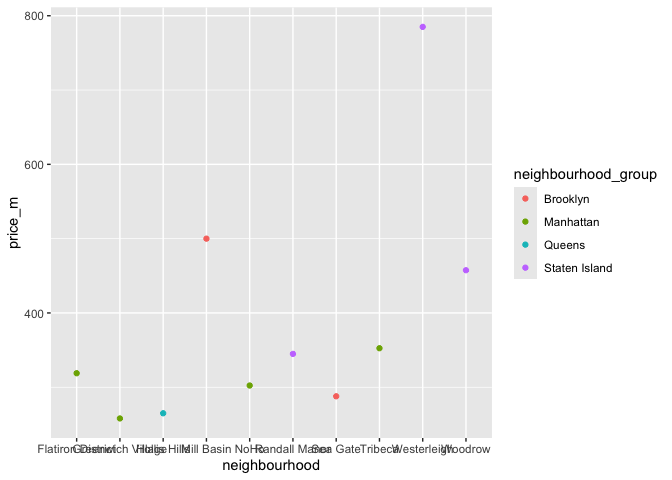<!-- -->

## Longpca?

``` r
## Specify PCA
formula = 1 ~ (neighbourhood_group & neighbourhood)*(name)
im = make_interaction_model(nyc_airbnb, formula, parse_text = TRUE, to_lower = TRUE)

## Filter Text
### Create neighborhood vector:
neighbourhood_list <- nyc_airbnb |> 
  pull(neighbourhood) |> 
  tolower() |> 
  str_split(pattern = " ") |> 
  unlist() |> 
  unique() |> 
  c("stuy", "bedstuy", "bk", "nyc", "bedford")

im$column_universe = im$column_universe |> 
  anti_join(tidytext::stop_words, by = c("token"="word")) |> 
  filter(!(token %in% neighbourhood_list))
im = im |> subset_im()
im = core(im, core_threshold = 5)
```

    ## [1] "adding graph summaries (coreness and connected components)."

``` r
diagnose(im)
```

    ## Warning in scale_y_log10(): log-10 transformation introduced infinite values.

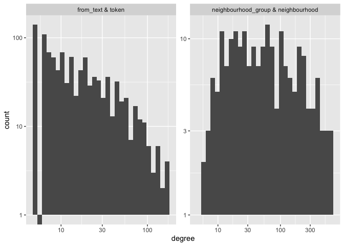<!-- -->

    ## # A tibble: 6 × 3
    ##   measurement     `from_text & token` `neighbourhood_group & neighbourhood`
    ##   <chr>                         <dbl>                                 <dbl>
    ## 1 number_of_items                1016                                   202
    ## 2 average_degree                   21                                   106
    ## 3 median_degree                    12                                    51
    ## 4 percent_le_1                      0                                     0
    ## 5 percent_le_2                      0                                     0
    ## 6 percent_le_3                      0                                     0

``` r
# Run PCA
pcs = pca(im, k = 6)
pca = rotate(pcs)

streaks(pca)
```

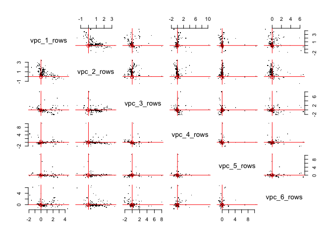<!-- --> \## Plot
PC1:

``` r
## Rows/cols with high loadings:
pca$row_features |> 
  arrange(desc(vpc_1_rows)) |> 
  head(n = 10) |> 
  ggplot(aes(x = reorder(neighbourhood, -vpc_1_rows), y = vpc_1_rows, fill = neighbourhood_group)) +
  geom_col() +
  theme(axis.text.x = element_text(angle = 45, hjust = 1)) +
  labs(x = "Neighbourhood", y = "VPC 1", fill = "Neighbourhood Group")
```

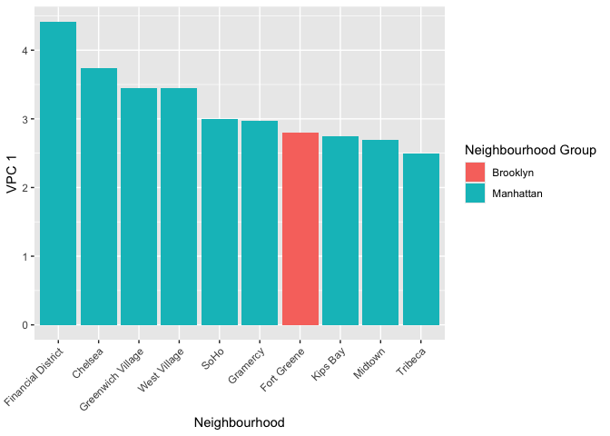<!-- -->

``` r
pca$column_features |> 
  arrange(desc(vpc_1_columns))
```

    ## # A tibble: 1,016 × 14
    ##    from_text token     n coreness component_label col_num degree weighted_degree
    ##    <chr>     <chr> <int>    <dbl>           <dbl>   <int>  <int>           <dbl>
    ##  1 name      loft   2075       46               1      12     78            2075
    ##  2 name      luxu…  1342       46               1      19     82            1341
    ##  3 name      loca…  1346       46               1      18     72            1346
    ##  4 name      heart  1525       46               1      14     79            1525
    ##  5 name      stud…  3221       46               1       8    133            3219
    ##  6 name      prime   623       46               1      37     54             623
    ##  7 name      pent…   363       44               1      62     53             363
    ##  8 name      amaz…   724       46               1      31     80             724
    ##  9 name      door…   177       34               1     121     35             177
    ## 10 name      1br    1182       46               1      23     87            1182
    ## # ℹ 1,006 more rows
    ## # ℹ 6 more variables: vpc_1_columns <dbl>, vpc_2_columns <dbl>,
    ## #   vpc_3_columns <dbl>, vpc_4_columns <dbl>, vpc_5_columns <dbl>,
    ## #   vpc_6_columns <dbl>

``` r
## Rows/cols with low loadings:
pca$row_features |> 
  arrange(vpc_1_rows) |> 
  head(n = 10) |> 
  ggplot(aes(x = reorder(neighbourhood, vpc_1_rows), y = vpc_1_rows, fill = neighbourhood_group)) +
  geom_col() +
  theme(axis.text.x = element_text(angle = 45, hjust = 1)) +
  labs(x = "Neighbourhood", y = "VPC 1", fill = "Neighbourhood Group")
```

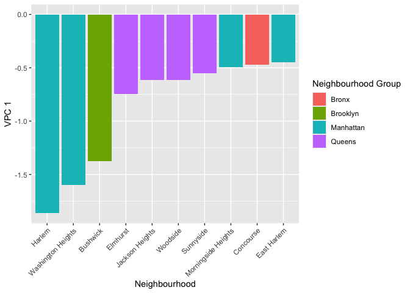<!-- -->

``` r
pca$column_features |> 
  arrange(vpc_1_columns)
```

    ## # A tibble: 1,016 × 14
    ##    from_text token     n coreness component_label col_num degree weighted_degree
    ##    <chr>     <chr> <int>    <dbl>           <dbl>   <int>  <int>           <dbl>
    ##  1 name      mins    286       43               1      77     56             286
    ##  2 name      min     500       46               1      43     77             500
    ##  3 name      15      250       40               1      87     45             250
    ##  4 name      train   457       46               1      49     68             457
    ##  5 name      jfk     239       29               1      91     44             239
    ##  6 name      minu…   271       43               1      81     65             270
    ##  7 name      subw…   611       46               1      38     84             611
    ##  8 name      lga      95       22               1     167     25              95
    ##  9 name      20      189       42               1     111     55             189
    ## 10 name      airp…    73       23               1     213     27              73
    ## # ℹ 1,006 more rows
    ## # ℹ 6 more variables: vpc_1_columns <dbl>, vpc_2_columns <dbl>,
    ## #   vpc_3_columns <dbl>, vpc_4_columns <dbl>, vpc_5_columns <dbl>,
    ## #   vpc_6_columns <dbl>

## Plot PC2:

``` r
## Rows/cols with high loadings:
pca$row_features |> 
  arrange(desc(vpc_2_rows)) |> 
  head(n = 10) |> 
  ggplot(aes(x = reorder(neighbourhood, -vpc_2_rows), y = vpc_2_rows, fill = neighbourhood_group)) +
  geom_col() +
  theme(axis.text.x = element_text(angle = 45, hjust = 1)) +
  labs(x = "Neighbourhood", y = "VPC 2", fill = "Neighbourhood Group")
```

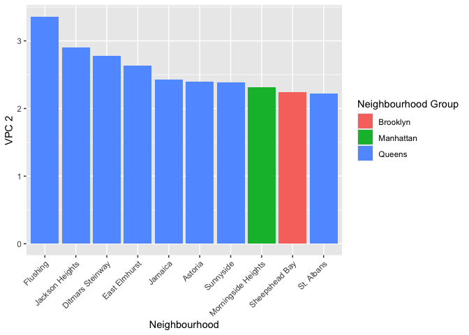<!-- -->

``` r
pca$column_features |> 
  arrange(desc(vpc_2_columns))
```

    ## # A tibble: 1,016 × 14
    ##    from_text token     n coreness component_label col_num degree weighted_degree
    ##    <chr>     <chr> <int>    <dbl>           <dbl>   <int>  <int>           <dbl>
    ##  1 name      priv…  6027       46               1       2    168            6025
    ##  2 name      bedr…  6721       46               1       1    169            6721
    ##  3 name      cozy   4221       46               1       5    166            4218
    ##  4 name      apar…  5078       46               1       3    166            5075
    ##  5 name      1      3687       46               1       6    144            3687
    ##  6 name      stud…  3221       46               1       8    133            3219
    ##  7 name      apt    4556       46               1       4    131            4556
    ##  8 name      2      2834       46               1       9    141            2834
    ##  9 name      spac…  3271       46               1       7    140            3270
    ## 10 name      jfk     239       29               1      91     44             239
    ## # ℹ 1,006 more rows
    ## # ℹ 6 more variables: vpc_1_columns <dbl>, vpc_2_columns <dbl>,
    ## #   vpc_3_columns <dbl>, vpc_4_columns <dbl>, vpc_5_columns <dbl>,
    ## #   vpc_6_columns <dbl>

``` r
## Rows/cols with low loadings:
pca$row_features |> 
  arrange(vpc_2_rows) |> 
  head(n = 10) |> 
  ggplot(aes(x = reorder(neighbourhood, vpc_2_rows), y = vpc_2_rows, fill = neighbourhood_group)) +
  geom_col() +
  theme(axis.text.x = element_text(angle = 45, hjust = 1)) +
  labs(x = "Neighbourhood", y = "VPC 1", fill = "Neighbourhood Group")
```

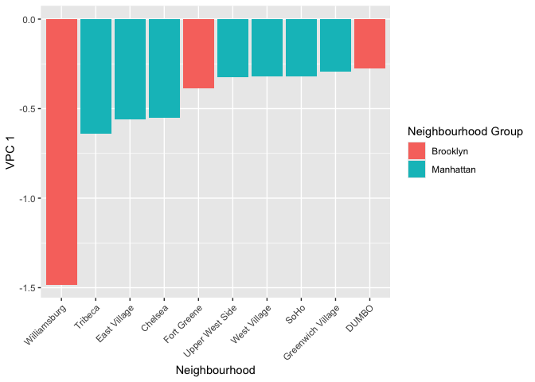<!-- -->

``` r
pca$column_features |> 
  arrange(vpc_2_columns)
```

    ## # A tibble: 1,016 × 14
    ##    from_text token     n coreness component_label col_num degree weighted_degree
    ##    <chr>     <chr> <int>    <dbl>           <dbl>   <int>  <int>           <dbl>
    ##  1 name      hip     186       34               1     116     35             186
    ##  2 name      hips…    18        8               1     522      8              18
    ##  3 name      arti…   320       42               1      70     45             320
    ##  4 name      time    187       19               1     115     19             187
    ##  5 name      roof…   217       36               1      95     37             217
    ##  6 name      funky    34       13               1     351     13              34
    ##  7 name      crea…    50       19               1     266     19              50
    ##  8 name      arti…    62       19               1     233     20              62
    ##  9 name      auth…    45       20               1     286     20              45
    ## 10 name      ecle…    32       14               1     364     14              32
    ## # ℹ 1,006 more rows
    ## # ℹ 6 more variables: vpc_1_columns <dbl>, vpc_2_columns <dbl>,
    ## #   vpc_3_columns <dbl>, vpc_4_columns <dbl>, vpc_5_columns <dbl>,
    ## #   vpc_6_columns <dbl>

## Plot PC3:

``` r
## Rows/cols with high loadings:
pca$row_features |> 
  arrange(desc(vpc_3_rows)) |> 
  head(n = 10) |> 
  ggplot(aes(x = reorder(neighbourhood, -vpc_3_rows), y = vpc_3_rows, fill = neighbourhood_group)) +
  geom_col() +
  theme(axis.text.x = element_text(angle = 45, hjust = 1)) +
  labs(x = "Neighbourhood", y = "VPC 3", fill = "Neighbourhood Group")
```

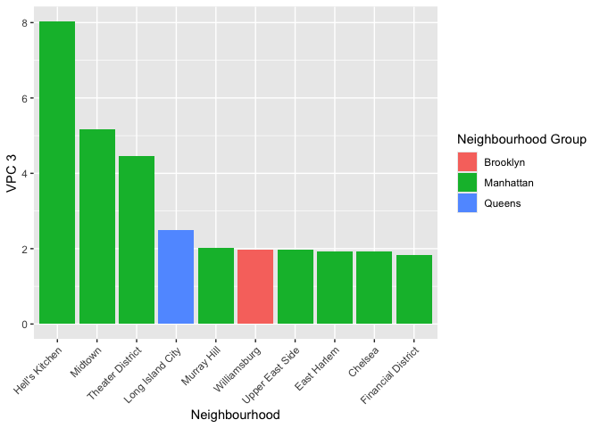<!-- -->

``` r
pca$column_features |> 
  arrange(desc(vpc_3_columns))
```

    ## # A tibble: 1,016 × 14
    ##    from_text token     n coreness component_label col_num degree weighted_degree
    ##    <chr>     <chr> <int>    <dbl>           <dbl>   <int>  <int>           <dbl>
    ##  1 name      times   664       33               1      33     34             664
    ##  2 name      time    187       19               1     115     19             187
    ##  3 name      cent…  1494       46               1      15     54            1494
    ##  4 name      sq      325       44               1      69     48             325
    ##  5 name      luxu…  1342       46               1      19     82            1341
    ##  6 name      buil…   341       41               1      64     47             341
    ##  7 name      min     500       46               1      43     77             500
    ##  8 name      15      250       40               1      87     45             250
    ##  9 name      minu…   271       43               1      81     65             270
    ## 10 name      walk    158       41               1     130     49             158
    ## # ℹ 1,006 more rows
    ## # ℹ 6 more variables: vpc_1_columns <dbl>, vpc_2_columns <dbl>,
    ## #   vpc_3_columns <dbl>, vpc_4_columns <dbl>, vpc_5_columns <dbl>,
    ## #   vpc_6_columns <dbl>

``` r
## Rows/cols with low loadings:
pca$row_features |> 
  arrange(vpc_3_rows) |> 
  head(n = 10) |> 
  ggplot(aes(x = reorder(neighbourhood, vpc_3_rows), y = vpc_3_rows, fill = neighbourhood_group)) +
  geom_col() +
  theme(axis.text.x = element_text(angle = 45, hjust = 1)) +
  labs(x = "Neighbourhood", y = "VPC 1", fill = "Neighbourhood Group")
```

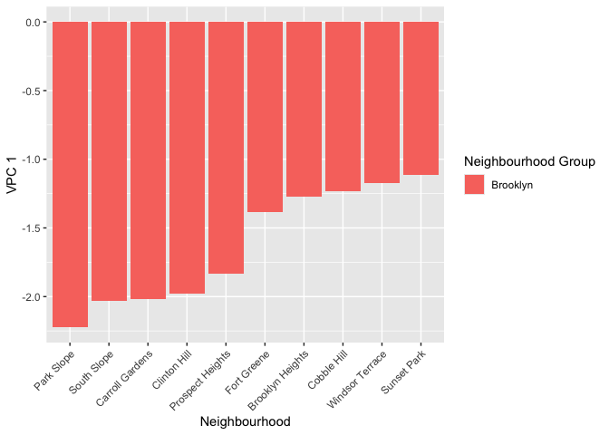<!-- -->

``` r
pca$column_features |> 
  arrange(vpc_3_columns)
```

    ## # A tibble: 1,016 × 14
    ##    from_text token     n coreness component_label col_num degree weighted_degree
    ##    <chr>     <chr> <int>    <dbl>           <dbl>   <int>  <int>           <dbl>
    ##  1 name      brow…  1012       41               1      26     45            1012
    ##  2 name      gard…   781       46               1      29     74             781
    ##  3 name      bklyn   104       24               1     158     24             104
    ##  4 name      char…  1292       46               1      20     95            1292
    ##  5 name      sunny  2831       46               1      10    105            2831
    ##  6 name      dupl…   743       46               1      30     59             743
    ##  7 name      house   521       46               1      42    119             518
    ##  8 name      hist…   327       42               1      66     51             327
    ##  9 name      town…   395       46               1      57     60             395
    ## 10 name      fami…   250       46               1      88     69             250
    ## # ℹ 1,006 more rows
    ## # ℹ 6 more variables: vpc_1_columns <dbl>, vpc_2_columns <dbl>,
    ## #   vpc_3_columns <dbl>, vpc_4_columns <dbl>, vpc_5_columns <dbl>,
    ## #   vpc_6_columns <dbl>

## Plot PC4:

``` r
## Rows/cols with high loadings:
pca$row_features |> 
  arrange(desc(vpc_4_rows)) |> 
  head(n = 10) |> 
  ggplot(aes(x = reorder(neighbourhood, -vpc_4_rows), y = vpc_4_rows, fill = neighbourhood_group)) +
  geom_col() +
  theme(axis.text.x = element_text(angle = 45, hjust = 1)) +
  labs(x = "Neighbourhood", y = "VPC 3", fill = "Neighbourhood Group")
```

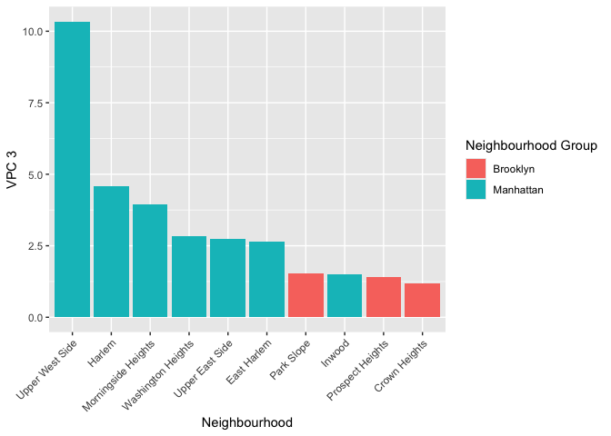<!-- -->

``` r
pca$column_features |> 
  arrange(desc(vpc_4_columns))
```

    ## # A tibble: 1,016 × 14
    ##    from_text token     n coreness component_label col_num degree weighted_degree
    ##    <chr>     <chr> <int>    <dbl>           <dbl>   <int>  <int>           <dbl>
    ##  1 name      uws     442        6               1      52      6             442
    ##  2 name      cent…  1494       46               1      15     54            1494
    ##  3 name      linc…    72        5               1     217      5              72
    ##  4 name      rive…    45        7               1     290      7              45
    ##  5 name      upto…   126        9               1     149      9             126
    ##  6 name      brow…  1012       41               1      26     45            1012
    ##  7 name      pk       46       15               1     280     15              46
    ##  8 name      steps   275       40               1      80     46             275
    ##  9 name      pre      88       33               1     180     33              88
    ## 10 name      war      87       33               1     183     33              87
    ## # ℹ 1,006 more rows
    ## # ℹ 6 more variables: vpc_1_columns <dbl>, vpc_2_columns <dbl>,
    ## #   vpc_3_columns <dbl>, vpc_4_columns <dbl>, vpc_5_columns <dbl>,
    ## #   vpc_6_columns <dbl>

``` r
## Rows/cols with low loadings:
pca$row_features |> 
  arrange(vpc_4_rows) |> 
  head(n = 10) |> 
  ggplot(aes(x = reorder(neighbourhood, vpc_4_rows), y = vpc_4_rows, fill = neighbourhood_group)) +
  geom_col() +
  theme(axis.text.x = element_text(angle = 45, hjust = 1)) +
  labs(x = "Neighbourhood", y = "VPC 1", fill = "Neighbourhood Group")
```

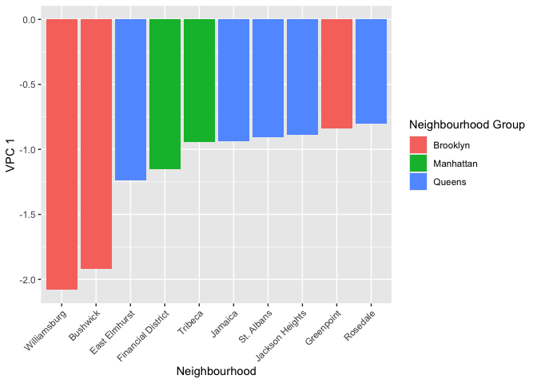<!-- -->

``` r
pca$column_features |> 
  arrange(vpc_4_columns)
```

    ## # A tibble: 1,016 × 14
    ##    from_text token     n coreness component_label col_num degree weighted_degree
    ##    <chr>     <chr> <int>    <dbl>           <dbl>   <int>  <int>           <dbl>
    ##  1 name      loft   2075       46               1      12     78            2075
    ##  2 name      jfk     239       29               1      91     44             239
    ##  3 name      union   171       11               1     123     11             171
    ##  4 name      airp…    73       23               1     213     27              73
    ##  5 name      lga      95       22               1     167     25              95
    ##  6 name      arti…   320       42               1      70     45             320
    ##  7 name      heart  1525       46               1      14     79            1525
    ##  8 name      15      250       40               1      87     45             250
    ##  9 name      house   521       46               1      42    119             518
    ## 10 name      min     500       46               1      43     77             500
    ## # ℹ 1,006 more rows
    ## # ℹ 6 more variables: vpc_1_columns <dbl>, vpc_2_columns <dbl>,
    ## #   vpc_3_columns <dbl>, vpc_4_columns <dbl>, vpc_5_columns <dbl>,
    ## #   vpc_6_columns <dbl>

## Visualize price more:

``` r
nyc_airbnb |> 
  filter(neighbourhood_group == "Manhattan") |> 
  filter(room_type == "Entire home/apt") |> 
  filter(price < 500) |> 
  ggplot(aes(x = lat, y = long, color = price)) +
  geom_point(alpha = 0.5)
```

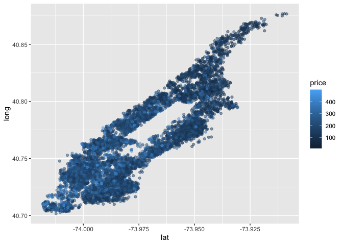<!-- -->
